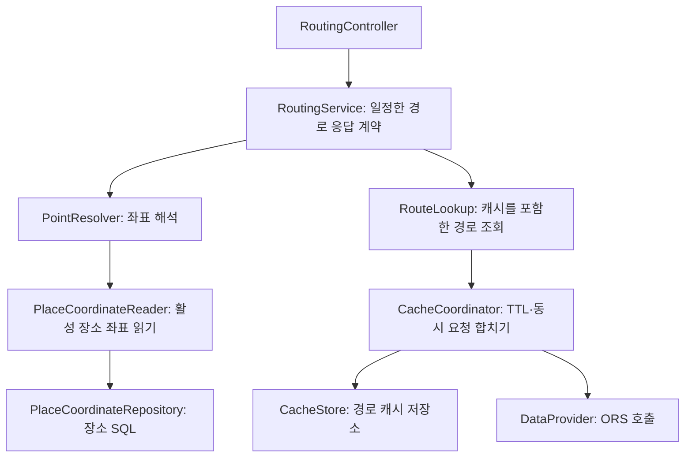

# ORS·장소 수집 유지보수 안내

기준: 2026-10-26. 대상은 `BackEnd/NestJS`다. 기존 HTTP 경로·응답·캐시 해시·보관시간·DB 구조를 유지하면서 책임과 의존성을 정리했다. ITS 소스는 재도입하지 않는다.

## ORS 요청 흐름



`RoutingService`는 TypeORM·HTTP 클라이언트·구체 캐시 클래스를 생성하거나 사용하지 않는다. 필요한 `PointResolver`와 `RouteLookup` 계약만 받는다. 실제 구현 연결은 `routing-cache.module.ts`의 provider factory에서 확인한다.

| 수정하려는 내용 | 파일 | 유지할 계약 |
|---|---|---|
| 활성 장소를 읽는 SQL | `place-coordinate.repository.ts` | 활성 장소만 반환, 없는 ID는 결과에서 제외 |
| 좌표 변환·원래 지점 순서·중복 지점 처리 | `route-point.resolver.ts` | 직접 좌표는 DB를 읽지 않음, 없는 장소 404·좌표 없는 장소 422 |
| ORS URL·요청·인증 헤더 | `ors.provider.ts`, `provider-http.ts` | 인증키를 저장/출력하지 않음, 실패를 정상 결과로 바꾸지 않음 |
| GeoJSON·구간 시간 변환과 검증 | `ors-response.mapper.ts` | 경도/위도 순서, 미터/초 단위, 구간 인덱스·시간 합계 검사 |
| 캐시 조회·UPSERT SQL | `cache-repositories.ts` | 같은 요청 해시는 같은 행 갱신, 기존 UUID 유지 |
| DB 드라이버 오류 정제 | `cache-database.ts`, `routing.errors.ts` | 원문·SQL·파라미터 노출 없이 오류 코드만 전달 |
| 필수 컬럼 확인·만료 삭제 SQL | `ors-cache-maintenance.repository.ts` | ORS 테이블만 사용, 만료 행에 SKIP LOCKED 적용 |
| 기동 진단·매분 호출 | `cache-maintenance.ts` | `CacheMaintenanceStore`의 schema/cleanup 두 동작만 필요 |
| TTL·정리 한도·스케줄 | `routing.policy.ts` | 현재 24시간·최대 1,000행·매분, 활성화 플래그 없음 |

`routing.ports.ts`는 소비자가 요구하는 기능, `routing.types.ts`는 요청·응답·저장 데이터 형식이다. 원천 응답 변환은 HTTP 없이 실행할 수 있고 저장소에서도 같은 검증 함수를 재사용한다.

24시간은 저장한 성공 응답의 유효기간이다. 만료 후 다음 요청에서 ORS를 다시 호출하며, 매분 작업은 만료 행만 삭제한다. TTL을 바꾸면 `routing.policy.ts`와 DDL 기본값·설명서를 함께 검토한다. 실제 저장의 expires_at은 서버가 명시적으로 전달한다.

## 장소 수집과 배치

기존 `TourIngestionService` → `ReferenceLoader` / `DetailLoader` / `ListPlanResolver` / `PlaceWriter` / `IngestionGate` 구조를 유지한다. 저장소는 SQL, 매퍼는 데이터 변환, 세션은 트랜잭션·잠금을 담당한다.

| 수정하려는 내용 | 파일 | 유지할 계약 |
|---|---|---|
| 목록 수집 방식·정렬·필터 | `tour-list-plans.ts`의 `ListStrategy` | 원래 페이지 진행·저장·결과 집계 흐름과 분리 |
| 상세 API 요청 순서·파라미터 정책 | `tour-detail.plan.ts`의 `DetailStep` | 공통/소개/반복/이미지 네 응답이 모두 성공해야 상세 묶음 반환 |
| 상세 조회·ID 검증·수집 시각 | `tour-detail.service.ts` | 일부 요청 실패 시 부분 묶음 반환 금지, 중복·필수 단계 누락 거부 |
| CLI·배치 공통 조립과 정책 주입 | `tour-run.factory.ts` | 실행마다 새 API 클라이언트와 요청 예산 사용 |
| 수동 HTTP 입력의 기본값·문자열 변환·범위 제한 | `batch/tour-manual.options.ts` | 기존 HTTP 기본값/변환 유지; CLI 파서와 동일 규칙이라고 가정하지 않음 |
| 중복 실행 방지·날짜 범위·완료 판정 | `batch/tour-batch.runner.ts` | 수동 실행은 성공 체크포인트를 전진시키지 않음 |
| 수동 API와 실행기 연결 | `batch/tour-batch.controller.ts` | `TourBatchCommands`의 run/runManual만 요구 |

`createTourRun`의 선택적인 다섯 번째 인수로 목록 전략·상세 조회 단계·시계를 바꿀 수 있다. 기본 CLI·배치는 인수를 생략하므로 기존 설정으로 실행된다.

```ts
const run = createTourRun(api, gate, categories, places, {
  listStrategies: customListStrategies,
  detailSteps: customDetailSteps,
  now: () => new Date(),
});
```

같은 mode의 목록 전략을 교체하려면 기본 전략 배열에서 해당 항목을 바꾼다. 기본 배열에 같은 mode를 추가하면 중복 등록 오류다. 상세 구성은 현재 지원하는 소개·반복·이미지 세 단계를 모두 포함해야 한다. 순서와 요청 파라미터를 바꿀 수 있으며, 새 원천 API 도입은 API 계약·타입·매핑·사용 조건의 별도 검토가 필요하다.

## SOLID 적용과 확인 범위

| 원칙 | 적용 | 확인한 근거 |
|---|---|---|
| SRP | HTTP/응답 변환/장소 SQL/좌표 해석/캐시 유지관리 SQL/스케줄을 분리하고 수동 입력 변환을 실행기에서 이동 | 변환·SQL·실행 정책을 각각 실행 |
| OCP | 같은 포트를 지키는 구현과 목록 전략·상세 요청 정책을 조립부에서 주입 | 수집 루프를 고치지 않고 사용자 전략과 상세 파라미터 정책 실행 |
| LSP | 불필요한 상속 대신 반환값·오류·부수효과 계약을 지키는 구현으로 치환 | 메모리/SQL 좌표 읽기에 같은 계약 검사 적용, 실패·순서·중복 확인 |
| ISP | 경로 서비스는 resolve/get, 유지관리는 schema/cleanup, HTTP 컨트롤러는 업무 명령만 요구 | 관련 없는 메서드가 없는 최소 구현으로 실행·TypeScript 검사 |
| DIP | 업무 서비스는 포트에 의존하고 Nest 모듈이 구체 어댑터를 연결 | TypeORM·실제 HTTP 없는 서비스 테스트 및 실제 Nest 모듈의 모킹 통합 검사 |

OCP의 범위는 기존 데이터 계약 안의 구현·전략·요청 정책 교체다. 새 기능이 모든 파일 수정 없이 추가된다는 뜻은 아니다. 계약 테스트는 확인한 동작의 근거이며 모든 미래 구현을 자동으로 보증하지 않는다.

## 검증과 배포

- Node 22.23.3: 기존 npm test 17개, 저장소 밖 ORS/DB 진단 32개·기존 배치 17개·SOLID 계약 13개, 총 79개 통과.
- SQL은 임시 PGlite, 제공자 응답은 모킹이다. 타입 계약·로컬 HTTP·Cron 등록·장소 UUID 유지·기본 상세 수집·실패 후 재시도·ORS 캐시 만료를 확인했다.
- 검증 전용 스크립트는 기존 사용자 결정에 따라 저장소 밖에 보관한다. 배포 체크아웃의 npm test는 기존 17개를 실행한다.
- 실제 외부 API 호출·원격 DB 변경·운영 배포는 하지 않았다. DB DDL이나 환경 파일 변경 없이 코드 배포로 적용한다.

서비스 폴더에서 `npm test`와 `npm run build:prod`를 실행한다. 새 기능 검증에서는 외부 API/DB 연동과 대역 검증을 구분해서 기록한다.

## 처음 읽는 팀원을 위한 안내

[장소·경로 코드 읽는 순서](PLACE_ROUTING_CODE_GUIDE.md)에 파일별 담당과 입력/출력 예시, 로그 해석을 추가했다. 운영 소스에는 함수·생성자·내부 콜백·인터페이스 메서드까지 한글 입출력·예시 주석을 달고 자료형 필드의 단위와 의미도 적었다. 이번 설명·들여쓰기 정리 전후의 주석 제외 실행 구문이 같음을 확인했으며 전체 79개 검증을 다시 통과했다.

## 심화 검증 후 보완

[추가 검사 보고서](PLACE_ROUTING_TEST_REPORT_2026-10-26.md)에서 수동 입력·분기, 불완전 목록, 복합 요금, 빈 ORS 구간 문제를 재현해 수정했다. 공통 assertIngestionOptions와 assertCompletePage를 사용하며 정상 입력의 HTTP 기본값은 유지한다. 최신 검증은 전체 130개 통과다. 오류 수정 후에는 실행 코드가 바뀌었으므로 앞선 주석 전후 동일성 비교를 이번 수정 전체의 동일성 근거로 사용하지 않는다.
