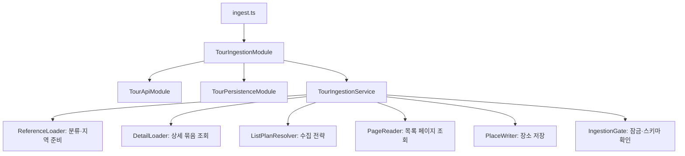

# 장소 수집 모듈

TourAPI에서 분류·장소·상세정보를 읽어 PostgreSQL의 `place_categories`와 `places`에 저장한다. 실행 진입점은 서버 CLI이며 [전체 사용법](../../docs/TOUR_INGESTION.md)에서 환경변수·옵션·필드 매핑을 확인할 수 있다. 스키마 기준은 [DDL v2](../../../../DataBase/place_schema_v2.sql)다.

## 왜 places에 2건만 있는가

최초 실연동 테스트를 아래 범위로 제한했기 때문이다. API가 제공하는 장소 전체 개수가 2개라는 의미는 아니다.

| 테스트 옵션 | 값 | 의미 |
|---|---|---|
| `--region` | `26` | 부산광역시 |
| `--district` | `380` | 사하구 |
| `--content-type` | `12` | 관광지 |
| `--page-size` | `2` | 한 페이지 2건 |
| `--max-pages` | `1` | 한 페이지까지만 처리 |

저장된 장소는 부산 감천문화마을(`1997221`)과 낙동강문화관(`2554141`)이다. 마지막 테스트 결과는 `nextPages.list=2`여서 이어서 조회할 페이지가 있었다. 분류 315개는 별도로 전체 분류 코드를 수집한 결과다. 장소와 분류의 수집 범위는 다르다.

`--page-size`의 기본값은 20이고 기본 `--max-pages`는 1이다. 2건 제한은 테스트 명령에 명시한 값이며 코드에 고정된 장소 수 제한이 아니다. `nextPages`의 각 값이 `null`이면 해당 필터·분할의 마지막 페이지까지 도달한 것이다. `completed`만으로 전국 전체 수집이 끝났다고 판단하지 않는다.

## 책임과 의존성

Nest 모듈은 외부 API 연결, DB 저장, 수집 흐름 구성으로 나눈다. 실제 클래스의 조립은 모듈의 provider factory에서만 수행한다. 각 서비스는 필요한 동작을 정의한 [인터페이스](tour-ingestion.ports.ts)를 생성자로 받는다.



| 구성요소 | 책임 | 변경 시점 |
|---|---|---|
| [TourApiModule](tour-api.module.ts), [TourApiClient](tour-api.client.ts) | 인증·HTTP·응답 검증·전체 페이지 조회·요청 예산 | 외부 API 통신 규칙 변경 |
| [TourPersistenceModule](tour-persistence.module.ts) | DB 구현과 매퍼를 조립 | 저장 구현 교체 |
| [TourDbSession](tour-db.session.ts) | 트랜잭션·잠금·연결 반환·스키마 확인 | DB 실행 정책 변경 |
| [TourCategoryRepository](tour-category.repository.ts) | 분류 SQL UPSERT | 분류 저장 쿼리 변경 |
| [TourStore](tour-store.ts) | 장소 SQL UPSERT | 장소 저장 쿼리 변경 |
| [TourReferenceService](tour-reference.service.ts) | 분류·지역 준비, 실행별 시군구 캐시 | 참조 정보 준비 방식 변경 |
| [TourDetailService](tour-detail.service.ts) | 공통·소개·반복·이미지 상세를 전부 성공한 묶음으로 반환 | 상세 조회 규칙 변경 |
| [TourListPlans](tour-list-plans.ts) | initial/sync/festivals별 API·필터·표시 구분 구성 | 수집 전략 추가·교체 |
| [TourPlaceMapper](tour-place.mapper.ts), [변환 함수](tour-mapping.ts) | 기본·상세 병합, 이미지·요금 변환, 변경 여부 판정 | 데이터 변환 정책 변경 |
| [TourIngestionService](tour-ingestion.service.ts) | 위 기능을 호출하고 페이지 진행·결과를 집계 | 전체 업무 흐름 변경 |
| [tour-provenance.ts](tour-provenance.ts) | 수집 URL·원본의 인증정보 제거 | 출처 보관 정책 변경 |
| [ingest.ts](ingest.ts), [옵션 파서](tour-ingestion.options.ts) | CLI 입력 검증·실행·안전한 결과 출력 | 명령 사용법 변경 |

[tour-types.ts](tour-types.ts)는 공유 데이터 계약, [tour-errors.ts](tour-errors.ts)는 안전하게 보고할 오류를 정의한다. 서비스에서 HTTP 클라이언트·저장소를 직접 생성하지 않는다.

## SOLID 적용

| 원칙 | 적용한 내용 | 확인 방법 |
|---|---|---|
| SRP · 단일 책임 | 상세 조회는 DB를 모르고, 매퍼는 SQL을 실행하지 않으며, 저장소는 변환 규칙을 직접 구현하지 않는다. | 상세 실패·순수 매핑·트랜잭션을 각각 분리해 테스트 |
| OCP · 개방/폐쇄 | 목록 조회 방식을 `ListStrategy`로 등록한다. 전략을 교체해도 페이지 처리·저장·집계 코드는 유지한다. | 사용자 정의 전략을 주입해 같은 수집 서비스로 실행 |
| LSP · 리스코프 치환 | 상속 계층을 만들지 않고 포트의 반환값·오류·부수효과 계약을 지키는 구현으로 교체한다. | 같은 PageReader 계약 검사를 HTTP 어댑터와 메모리 구현에 적용 |
| ISP · 인터페이스 분리 | 분류 준비는 `ReferenceReader.all`과 `CategoryWriter.categories`만, 상세 조회는 `DetailReader`만 받는다. 장소 저장·잠금도 별도 포트다. | 불필요한 메서드가 없는 최소 대역으로 각 기능 실행 |
| DIP · 의존 역전 | 수집 서비스는 `IngestionDependencies` 인터페이스에 의존한다. Nest 모듈에서 실제 API·DB 구현을 연결한다. | 외부 API·실제 DB 없는 서비스 테스트와 Nest DI 구성 테스트 |

OCP의 적용 범위는 목록 수집 전략이다. 새 CLI 모드나 새로운 외부 API 응답 형식을 추가하면 옵션 검증·엔드포인트 타입·변환 정책의 수정도 필요하다. LSP 테스트는 확인한 계약에 대한 근거이며 모든 대체 구현의 동작을 자동 보증하지 않는다.

## 유지하는 데이터 규칙

- `content_id`와 분류 코드가 같으면 기존 UUID를 유지한다. 장소를 TRUNCATE하거나 후기를 삭제하지 않는다.
- 목록 재수집은 설명·운영시간 등 기존 상세를 보존한다. 네 상세 API 중 하나라도 실패하면 상세 묶음을 저장하지 않는다.
- 데이터 내용이 같으면 `unchanged`로 집계하고 `updated_at`은 유지한다. 성공한 수집은 `last_synced_at`과 출처 메타데이터를 갱신한다.
- `source_type=API`, `source_url=마지막 성공 장소 요청 URL`로 저장한다. API별 URL·최신 원본은 `raw_data`에 보관하며 인증정보를 제거한다.
- `showflag=0`은 비활성화한다. 검색 결과에 없다는 이유로 장소를 삭제하지 않는다.
- 한 실행 전체가 하나의 트랜잭션은 아니다. 실패 전에 성공한 저장은 남고, `nextPages`부터 같은 조건으로 재시도할 수 있다.

## 실행 예시

아래 명령은 `BackEnd/NestJS`에서 실행한다. 선택한 환경에 DB 설정과 `TOUR_API_KEY`가 있어야 한다. 실제 키는 저장소에 기록하지 않는다.

```powershell
# 동일한 2건 실연동 테스트 범위
npm run tour:ingest -- dev --region 26 --district 380 --content-type 12 --page-size 2 --max-pages 1

# 같은 페이지 크기로 다음 페이지를 조회
npm run tour:ingest -- dev --region 26 --district 380 --content-type 12 --page-size 2 --start-page 2 --max-pages 1

# 사하구 관광지 목록을 더 넓게 수집: 최대 100건 × 10페이지, 상세 요청 생략
npm run tour:ingest -- dev --region 26 --district 380 --content-type 12 --page-size 100 --max-pages 10 --list-only

# 필요한 장소의 상세 보완
npm run tour:ingest -- dev --mode detail --content-id 1997221
```

페이지 크기를 바꾸면 `--start-page 1`부터 다시 조회한다. 같은 `content_id`는 UPSERT로 병합된다. `--list-only`로 새로 넣은 장소는 상세 요금·설명이 비어 있을 수 있으므로 상세 보완이 필요하다. 더 넓게 수집하는 위 명령은 사용 예시이며 이번 책임 분리 작업에서는 실행하지 않았다. 요청 예산 기본 200회와 제공기관 한도를 함께 고려한다. 상세 수집은 장소당 최소 네 요청을 추가로 사용한다.

## 테스트와 검증 기록

2026-10-22, Node.js 22.23.3에서 검증했다.

검증용 테스트 파일은 로컬에만 보관하고 배포 커밋에는 포함하지 않는다. 아래는 해당 파일이 있는 작업 환경에서 실행한 검증 명령이다.

```powershell
npm run build
node --test test/tour-ingestion.test.cjs test/tour-design.test.cjs
npm test
npm run build:prod
```

배포 커밋만 체크아웃한 환경에서는 `npm test`로 기존 Node 6개 + Jest 4개를 실행하고 `npm run build:prod`로 빌드한다.

| 검사 | 결과 | 범위 |
|---|---|---|
| 수집 회귀 `tour-ingestion.test.cjs` (로컬 전용) | 14개 통과 | 인증정보 제거, 페이지·예산, 필드 변환, 부분 실패, 동기화, CLI, Nest 모듈 구성 |
| 책임·계약 `tour-design.test.cjs` (로컬 전용) | 11개 통과 | 구현 치환, 좁은 포트, 캐시 수명·재시도, 전략 주입, 상세 ID 검증, 매핑·잠금·롤백·장소 저장 |
| 검증 파일이 있는 로컬의 전체 `npm test` | Node 31개 + Jest 4개, 총 35개 통과 | 기존 여행·인증·환경·DB 설정 회귀 포함 |
| `npm run build:prod` | 통과 | 운영 TypeScript 컴파일 |
| 격리 PostgreSQL 엔진(PGlite), 별도 임시 검증 | 통과 | 분리한 세션·분류 저장소·장소 저장소의 실제 SQL, UUID 유지, 상세 병합, 요금·이미지, unchanged, 비활성화 후 후기 FK 유지 |

일반 테스트는 API 응답과 DB를 대체한 자동 테스트이며 실제 TourAPI 가용성·원격 DB 연결을 검사하지 않는다. PGlite 검증은 임시 실행 환경에서 수행했으며 프로젝트 의존성이나 `npm test`에 포함하지 않았다. 기존 [실연동 기록](../../../../DataBase/place_source_metadata_applied_2026-10-22.md)은 분류 315개·장소 2건, 실제 API 26요청이다. 이번 리팩터링에서는 원격 DB에 추가 쓰기나 API 호출을 하지 않았다.

장소·후기 웹 CRUD, 크롤러, 자동 수집 스케줄, ORS·ITS 연동과 운영 배포는 구현 범위에 포함하지 않는다.
