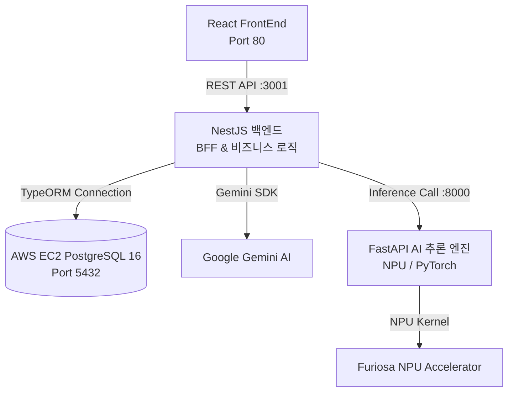

# 🚀 BackEnd 마스터 허브 가이드 (Multi-Backend Architecture)

> **길벗 AI 여행사의 백엔드는 역할에 따라 2개의 전문 백엔드 서비스(NestJS & FastAPI)로 분리되어 유기적으로 협업합니다.**

---

## 📑 백엔드 서브시스템 구성

```
BackEnd/
├── nestjs/             # [메인 웹 & 비즈니스 로직 서버] NestJS 11 + TypeORM + PostgreSQL + Gemini Multi-Agent
│   ├── src/
│   ├── test/
│   ├── scripts/
│   ├── docs/           # NestJS 상세 기술/아키텍처/실행/환경 문서
│   ├── Dockerfile
│   └── README.md
│
└── fastapi/            # [고성능 AI 추론 엔진] Python 3.12 + FastAPI + NPU/PyTorch 지원
    ├── main.py
    ├── requirements.txt
    ├── Dockerfile
    └── README.md
```

---

## 🏛️ 마이크로서비스 역할 분담 및 통신 구조



| 서브시스템 | 기술 스택 | 포트 | 주요 역할 |
|---|---|---|---|
| **`BackEnd/nestjs`** | NestJS 11, TypeScript, TypeORM, Express | `3001` | • 프론트엔드 BFF (Backend For Frontend)<br/>• 사용자 요청 검증 및 DB 트랜잭션<br/>• 7인 AI 멀티에이전트 파이프라인 조율<br/>• 여행 일정 승인 상태 머신 관리 |
| **`BackEnd/fastapi`** | FastAPI, Python 3.12, Uvicorn, Pydantic | `8000` | • 고속 데이터 연산 및 비동기 처리<br/>• Furiosa NPU 전용 추론 인터페이스<br/>• 딥러닝/임베딩 모델 및 벡터 검색 서빙 |

---


## ⚡ 빠른 실행 명령어 (Quick Start)

### NestJS 실행
```bash
cd BackEnd/nestjs
npm install
npm run start:dev     # 핫 리로드 개발 서버 (포트 3001)
npm test               # 격리 테스트 실행
```

### FastAPI 실행
```bash
cd BackEnd/fastapi
pip install -r requirements.txt
uvicorn main:app --host 0.0.0.0 --port 8000 --reload
```
