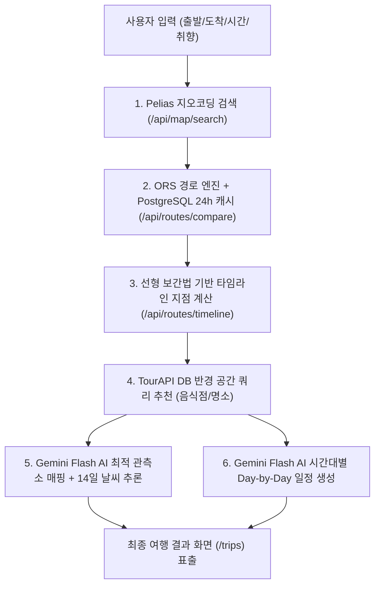
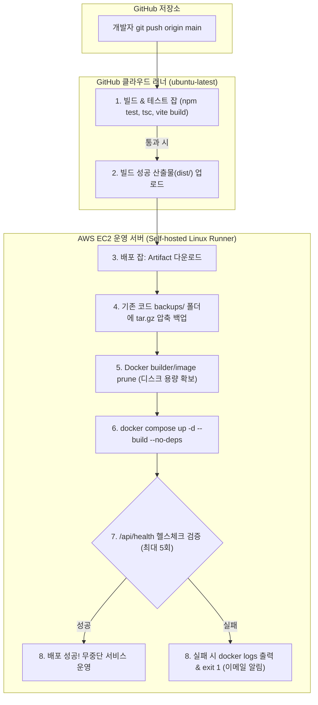

# 🧭 길벗 AI 여행사 — 개발자를 위한 시스템 아키텍처 & CI/CD 완벽 가이드

> **대상 독자**: 웹 개발 및 인프라를 처음 접하는 초보 개발자부터 주니어 엔지니어까지  
> **프로젝트**: 퓨리오사 AI 부트캠프 미니 프로젝트 (길벗 여행사 — I AM YOUR J)  
> **핵심 키워드**: React 19, NestJS 12, FastAPI, PostgreSQL, Docker Compose, GitHub Actions, OpenRouteService, Google Gemini 2.5 Flash, 10개년 기후 빅데이터

---

## 📑 목차
- [Part 1. 여행 관련 핵심 비즈니스 로직](#part-1-여행-관련-핵심-비즈니스-로직)
  - [1. 여행 경로는 어떤 방식으로 생성되는가?](#1-여행-경로는-어떤-방식으로-생성되는가)
  - [2. 여행지(맛집·관광지)는 어떤 방식으로 추천되는가?](#2-여행지맛집관광지는-어떤-방식으로-추천되는가)
  - [3. 출발지와 도착지를 검색할 때는 어떤 API를 쓰는가?](#3-출발지와-도착지를-검색할-때는-어떤-api를-쓰는가)
  - [4. 여행지 데이터는 어디서 가져온 것인가? (TourAPI)](#4-여행지-데이터는-어디서-가져온-것인가-tourapi)
  - [5. API들과 AI 연동은 어디부터 어디까지 되어 있는가?](#5-api들과-ai-연동은-어디부터-어디까지-되어-있는가)
  - [6. 채팅 서비스(I AM YOUR J)와 API는 어떻게 연동되는가?](#6-채팅-서비스i-am-your-j와-api는-어떻게-연동되는가)
- [Part 2. CI/CD 및 도커 인프라 아키텍처](#part-2-cicd-및-도커-인프라-아키텍처)
  - [1. 어떤 CI/CD 도구를 사용했는가? (GitHub Actions)](#1-어떤-cicd-도구를-사용했는가-github-actions)
  - [2. 코드를 push하면 어떤 방식으로 자동 배포되는가?](#2-코드를-push하면-어떤-방식으로-자동-배포되는가)
  - [3. 배포 중 에러가 발생하면 개발자에게 어떻게 피드백이 오는가?](#3-배포-중-에러가-발생하면-개발자에게-어떻게-피드백이-오는가)
  - [4. 도커(Docker)와 컨테이너들은 어떻게 연결되어 있는가?](#4-도커docker와-컨테이너들은-어떻게-연결되어-있는가)
  - [5. 새 버전의 최신 컨테이너는 어떻게 배포되는가?](#5-새-버전의-최신-컨테이너는-어떻게-배포되는가)
  - [6. 서버가 죽지 않고 계속 살아있도록(자가 치유) 어떻게 모니터링하는가?](#6-서버가-죽지-않고-계속-살아있도록자가-치유-어떻게-모니터링하는가)

---

# Part 1. 여행 관련 핵심 비즈니스 로직



---

### 1. 여행 경로는 어떤 방식으로 생성되는가?

#### 💡 쉬운 비유
> 서울에서 부산까지 갈 때 네비게이션이 티맵 서버에 길을 물어보듯, 우리 서버도 세계 최고의 오픈 도로망 데이터 엔진(OpenRouteService)에 도로 경로를 물어보고 그 결과를 지도 위에 예쁜 선으로 그려줍니다.

#### ⚙️ 동작 원리 및 코드 흐름
1. **사용자 요청**: 사용자가 웹 화면에서 출발지(예: 서울역)와 도착지(예: 해운대)를 고르면 위도와 경도 좌표(예: `[126.97, 37.55]`와 `[129.15, 35.15]`)가 백엔드 `POST /api/routes/compare`로 넘어갑니다.
2. **1단계 — 24시간 DB 캐시 검사**:
   - 동일한 좌표의 경로는 매번 외부 API를 호출하면 돈과 시간이 낭비됩니다.
   - 백엔드는 먼저 PostgreSQL의 `routes_cache` 테이블을 확인하여 24시간 내에 계산된 경로가 있는지 확인합니다.
3. **2단계 — 외부 HeiGIT OpenRouteService (ORS) API 호출**:
   - 캐시가 없으면 독일 하이델베르크 대학의 오픈 경로 엔진인 ORS API(`https://api.openrouteservice.org/v2/directions/driving-car` 및 `foot-walking`)를 호출합니다.
   - 이때 **권장 경로(`recommended`)**와 **최단 경로(`shortest`)** 2가지 경로를 동시에 받아옵니다.
4. **3단계 — GeoJSON 좌표열 수집 및 시각화**:
   - ORS가 넘겨준 수천 개의 위경도 점으로 이루어진 `LineString` 기하 데이터를 프론트엔드의 Leaflet 지도 엔진에 전달하여 실제 고속도로/국도 모양 그대로 도로선을 그립니다.
5. **타임라인 경로 계산 (선형 보간법, Linear Interpolation)**:
   - `POST /api/routes/timeline`에서는 각 도로 구간을 지나는 데 걸리는 시간(`timeSpans`)을 누적 계산합니다.
   - 만약 09:30에 출발해서 "12:30 점심 식사"를 원한다면, 3시간(10,800초) 주행 시점에 통과하고 있을 고속도로 위의 정확한 위경도 지점을 **비례식(선형 보간)**으로 수학적으로 계산해냅니다.

---

### 2. 여행지(맛집·관광지)는 어떤 방식으로 추천되는가?

#### 💡 쉬운 비유
> "부산 시내 맛집"을 아무렇게나 추천하는 것이 아니라, 운전자가 12시 반쯤 지나갈 충북 영동 고속도로 IC 근처 5km 반경 안에서 가장 가까운 맛있는 올갱이국밥집을 추천해 주는 방식입니다.

#### ⚙️ 동작 원리 및 코드 흐름
1. **중심점(Waypoint) 산출**: 위 1번에서 계산된 차량의 이동 경로 좌표열 또는 시간대별 도로 통과 지점을 기준점(위도·경도)으로 잡습니다.
2. **반경 설정**: 기준점으로부터 기본 3,000m ~ 5,000m (최대 20,000m) 탐색 반경을 지정합니다.
3. **PostgreSQL 공간 거리 계산 (Haversine 공식)**:
   - 데이터베이스 내 수만 개의 장소(`places` 테이블)를 대상으로 구면 삼각법(Haversine Formula) 거리를 계산합니다.
   ```sql
   -- 도로 통과 중심점(lat0, lng0)과의 직선거리(m) 계산 예시
   6371000 * acos(
     cos(radians(lat0)) * cos(radians(latitude)) * 
     cos(radians(longitude) - radians(lng0)) + 
     sin(radians(lat0)) * sin(radians(latitude))
   ) AS distance_meters
   ```
4. **취향 카테고리 계층 필터링**:
   - 사용자가 "음식점"을 골랐다면 `contentTypeId = 39`만 필터링합니다.
   - DB의 `place_categories` 테이블에 대분류(한식, 일식 등)와 소분류가 트리 형태로 저장되어 있어, 상위 카테고리를 고르면 하위 카테고리까지 재귀적으로 포함하여 가장 가깝고 평점 좋은 장소를 선별합니다.

---

### 3. 출발지와 도착지를 검색할 때는 어떤 API를 쓰는가?

#### 💡 쉬운 비유
> 네이버나 구글 검색창처럼 글자를 타이핑할 때마다 아래에 추천 장소 목록이 주르륵 뜨는 자동완성 기능입니다.

#### ⚙️ 동작 원리 및 코드 흐름
1. **프론트엔드 최적화 ([MapPlaceSearch.tsx](file:///c:/furiosa-miniproject/FURIOSA_BOOTCAMP_miniproject/FrontEnd/v1/src/components/MapPlaceSearch.tsx))**:
   - 한글은 'ㄱ', '가', '강'처럼 조합 중(IME)일 때마다 검색하면 서버가 터집니다.
   - 따라서 글자 조합이 끝나고 사용자가 손을 뗀 후 **600ms(0.6초) 동안 추가 입력이 없을 때만(Debounce)** 백엔드로 요청을 보냅니다.
2. **백엔드 프록시 (`GET /api/map/search?text=...`)**:
   - 브라우저가 외부에 직접 API 키를 노출하지 않도록 NestJS 백엔드가 중간 다리 역할을 합니다.
3. **HeiGIT Pelias Geocoding API**:
   - 백엔드는 오픈소스 검색 엔진인 **Pelias API** (`/geocode/autocomplete` 및 `/geocode/search`)를 서버 전용 비밀키(`ORS_API_KEY`)로 호출합니다.
   - 한국어 지명(예: "해운대", "강릉역")을 해석하여 장소 이름, 상세 도로명 주소, 위도·경도 좌표를 JSON으로 정제해 프론트엔드로 전달합니다.

---

### 4. 여행지 데이터는 어디서 가져온 것인가? (TourAPI)

#### 💡 쉬운 비유
> 대한민국 정부(한국관광공사)가 공식적으로 관리하는 전국 모든 관광지와 맛집의 "공공 대백과사전" 데이터를 우리 데이터베이스로 통째로 가져와 정리해둔 것입니다.

#### ⚙️ 데이터베이스 구조
- **출처**: 공공데이터포털(data.go.kr)의 **한국관광공사 TourAPI 4.0 (국문 관광정보)**.
- **자체 DB 구축 (`places`, `place_categories`)**:
  - 외부 API를 실시간 호출하면 속도가 느리고 호출 제한(쿼터)에 걸리기 때문에, 배치(Batch) 프로그램을 통해 전국 장소 데이터를 우리 PostgreSQL에 미리 정제 적재했습니다.
- **핵심 분류 기준 (ContentTypeId)**:
  - `39`: 음식점 / 카페
  - `12`: 관광지
  - `14`: 문화시설 (미술관, 박물관)
  - `28`: 레포츠
  - `32`: 숙박 (호텔, 펜션)
- **분류 체계**: A01(자연), A02(인문), A05(음식) 등 대분류 ➔ 중분류 ➔ 소분류로 이어지는 정밀한 카테고리 UUID를 부여하여 맞춤 검색이 가능합니다.

---

### 5. API들과 AI 연동은 어디부터 어디까지 되어 있는가?

우리 시스템은 **규칙 기반 알고리즘(Rule-based)**과 **생성형 AI(LLM)**, **빅데이터 통계 모델**의 장점을 조화롭게 융합했습니다.

| 단계 | 역할 | 사용 기술 및 API | 설명 |
|---|---|---|---|
| **1단계** | 목적지 관측소 매핑 | **FastAPI + Google Gemini 2.5 Flash** | 사용자가 고른 목적지(예: '정동진 썬크루즈')를 보고 Gemini가 지리적 맥락을 파악해 가장 가까운 기상청 ASOS 관측소(강릉)로 1:1 매핑 |
| **2단계** | 14일 기상 예보 추론 | **10개년 기후 빅데이터 통계 모델** | 2015~2025년 기상청 관측치 빅데이터를 토대로 2주치(14일) 기온, 강수확률, 일교차, 자외선, 풍속 지표 산출 |
| **3단계** | 타임라인 도로 스팟 추출 | **NestJS + PostgreSQL + ORS** | 계산된 이동 경로 위의 휴게소와 점심 식사 장소를 DB 공간 쿼리로 정확한 좌표 기반 추출 |
| **4단계** | 여행 일정 큐레이션 | **NestJS + Google Gemini 2.5 Flash** | 추천된 장소들과 여행자의 스타일(힐링, 미식 등)을 주입해 1일차/2일차 시간대별 방문 순서표를 JSON으로 생성 |
| **5단계** | 감성 문학 리뷰 작성 | **Gemini 2.5 Flash** | 방문할 식당이나 관광지에 대해 시적이고 감성적인 문학적 해설 텍스트 작성 |

---

### 6. 채팅 서비스(I AM YOUR J)와 API는 어떻게 연동되는가?

#### 💡 쉬운 비유
> 스마트한 여행 플래너 친구(J형 성향)와 카카오톡으로 대화하듯 편하게 이야기하면, 친구가 대화 속에서 날짜와 장소를 쏙쏙 뽑아내어 완벽한 여행 계획표로 만들어주는 구조입니다.

#### ⚙️ 동작 메커니즘 ([FullScreenAiChatPlanner.tsx](file:///c:/furiosa-miniproject/FURIOSA_BOOTCAMP_miniproject/FrontEnd/v1/src/components/FullScreenAiChatPlanner.tsx))
1. **FSM (유한 상태 머신, State Machine)**:
   - 챗봇은 무작위로 아무 말이나 하는 것이 아니라 체계적인 단계(`step 1` 출발지 ➔ `step 2` 도착지 ➔ `step 3` 날짜/시간 ➔ `step 4` 취향 ➔ `step 5` 이동수단)를 따라 질문을 던집니다.
2. **자연어 추출 알고리즘 ([planner-survey.ts](file:///c:/furiosa-miniproject/FURIOSA_BOOTCAMP_miniproject/FrontEnd/v1/src/services/planner-survey.ts))**:
   - 사용자가 *"내일 아침 9시에 출발해서 1박 2일로 갈래"*라고 자연어로 대답하면, 내부 정규식과 날짜 파서(`scheduleFromText`)가 오늘 날짜를 기준으로 출발일(`YYYY-MM-DD`), 도착일, 시간(`09:00`)을 자동으로 계산해냅니다.
3. **실시간 장소 좌표 바인딩**:
   - 대화창에 지명(예: "속초 해수욕장")이 나오면 백엔드 Pelias 검색 API를 즉시 호출해 정확한 위·경도 좌표 객체로 확정합니다.
4. **결과 화면 자동 연동**:
   - 5가지 필수 조건이 모두 채워지면 플래너 서비스가 `planTrip()`을 호출하여 백엔드 타임라인 경로 API를 실행하고, 대화창을 닫으며 곧바로 [내 여행 결과 페이지(`/trips`)](file:///c:/furiosa-miniproject/FURIOSA_BOOTCAMP_miniproject/FrontEnd/v1/src/components/TripResultsPage.tsx)로 매끄럽게 연결합니다.

---

# Part 2. CI / CD 및 도커 인프라 아키텍처



---

### 1. 어떤 CI/CD 도구를 사용했는가? (GitHub Actions)

우리 프로젝트는 **GitHub Actions**를 기반으로 하되, 매우 스마트한 **하이브리드 러너(Hybrid Runner) 구조**를 채택했습니다.

- **CI(빌드/테스트) ➔ GitHub 클라우드 무료 러너 (`ubuntu-latest`)**:
  - 무거운 TypeScript 컴파일, 린트 검사, 단위 테스트는 GitHub의 클라우드 서버에서 대신 수행합니다.
  - **이유**: 운영 중인 EC2 서버의 CPU와 메모리를 전혀 갉아먹지 않기 위함입니다.
- **CD(배포) ➔ EC2 자체 호스팅 러너 (`self-hosted, linux`)**:
  - AWS EC2 안에 GitHub Runner 프로그램을 상주시켜, GitHub Actions가 직접 EC2 내부 셸 스크립트를 실행하게 합니다.
  - **이유**: 외부에 EC2 SSH 비밀키를 노출하거나 방화벽 포트를 열지 않아도 되어 보안상 매우 안전합니다.

---

### 2. 코드를 push하면 어떤 방식으로 자동 배포되는가?

1. **Path-based 자동 감지 (불필요한 배포 방지)**:
   - 프론트엔드 코드만 수정하면 `.github/workflows/deploy.yml`만 작동합니다.
   - 백엔드 코드만 수정하면 `.github/workflows/deploy_backend.yml`만 작동합니다.
   - AI 추론 코드만 수정하면 `.github/workflows/deploy_fastapi.yml`만 작동합니다.
2. **2단계 파이프라인 흐름**:
   - **Step 1 (`build` 잡)**: 소스코드 체크아웃 ➔ Node.js 22 세팅 ➔ `npm run build` 및 `npm test` 실행 ➔ 성공 시 생성된 번들(`dist/`)을 GitHub 서버에 **아티팩트(Artifact)**로 보관.
   - **Step 2 (`deploy` 잡)**: EC2 내부 러너가 `build` 잡 성공을 확인하고 아티팩트를 다운로드받아 [deploy.sh](file:///c:/furiosa-miniproject/FURIOSA_BOOTCAMP_miniproject/CI_CD/BackEnd/nestjs/deploy.sh) 실행.

---

### 3. 배포 중 에러가 발생하면 개발자에게 어떻게 피드백이 오는가?

#### 🛡️ 1차 방어선: 클라우드 빌드 실패 시 조기 차단 (Fail-Fast)
- 개발자가 실수로 오타를 내거나 테스트를 깨뜨린 코드를 push하면, GitHub 호스팅 러너 단계에서 즉시 빨간 불(X)이 들어오며 멈춥니다.
- **EC2 배포 잡은 아예 실행조차 되지 않으므로**, 운영 중인 서버에는 단 0.1%의 위험도 발생하지 않습니다.

#### 🛡️ 2차 방어선: 배포 후 5회 자동 헬스체크 (Health Check)
- 새 컨테이너가 뜬 후, 배포 스크립트가 로컬 엔드포인트(`http://127.0.0.1:3001/api/health`)로 신호를 보냅니다.
- 2초 간격으로 최대 5회 재시도하며 정상 응답(`200 OK`)이 오지 않으면:
  1. `docker compose logs --tail=50` 명령어가 즉각 실행되어 **컨테이너 내부 에러 로그 50줄**을 GitHub 액션 창에 시원하게 출력합니다.
  2. 스크립트가 종료 코드 `exit 1`로 실패 처리됩니다.

#### 📬 개발자 피드백
- GitHub 커밋 목록과 PR에 **빨간색 X 뱃지**가 표시됩니다.
- 개발자의 이메일로 실패 알림 메일이 즉시 발송됩니다.
- 배포 직전의 이전 소스코드가 EC2의 `backups/` 폴더에 타임스탬프가 붙은 `.tar.gz` 압축 파일로 보관되어 있어 1분 안에 직전 버전으로 되돌릴 수 있습니다.

---

### 4. 도커(Docker)와 컨테이너들은 어떻게 연결되어 있는가?

프로젝트 루트의 [docker-compose.yml](file:///c:/furiosa-miniproject/FURIOSA_BOOTCAMP_miniproject/docker-compose.yml) 파일 하나로 3개의 컨테이너가 가상 네트워크 안에서 서로 돕도록 묶여 있습니다.

```text
[인터넷 사용자 (브라우저)]
       │ (HTTP :80 / HTTPS :443)
       ▼
┌────────────────────────────────────────────────────────┐
│ travel-frontend 컨테이너 (React + Nginx)               │
│ - 웹사이트 화면 제공                                   │
│ - Let's Encrypt SSL 암호화 처리                         │
│ - 리버스 프록시 분기:                                  │
│     /api/*     ───► travel-backend:3001 로 토스        │
│     /fastapi/* ───► travel-fastapi:8000 로 토스        │
└────────────────────────────────────────────────────────┘
       │                                 │
       ▼ (내부 travel-network)           ▼ (내부 travel-network)
┌──────────────────────────┐    ┌────────────────────────┐
│ travel-backend 컨테이너  │    │ travel-fastapi 컨테이너│
│ - NestJS 메인 백엔드     │    │ - FastAPI AI 추론 엔진 │
│ - 포트 3001 점유         │    │ - 포트 8000 점유       │
└──────────────────────────┘    └────────────────────────┘
       │ (host.docker.internal)
       ▼
┌────────────────────────────────────────────────────────┐
│ AWS EC2 호스트 OS (PostgreSQL 데이터베이스)             │
└────────────────────────────────────────────────────────┘
```

- **`travel-network` (Docker Bridge Network)**: 컨테이너끼리는 서로의 이름을 마치 도메인 주소처럼(`http://backend:3001`, `http://fastapi:8000`) 부르며 고속으로 안전하게 통신합니다.

---

### 5. 새 버전의 최신 컨테이너는 어떻게 배포되는가?

[deploy.sh](file:///c:/furiosa-miniproject/FURIOSA_BOOTCAMP_miniproject/CI_CD/BackEnd/nestjs/deploy.sh)가 실행되면 서버 안에서 다음 일들이 자동으로 순서대로 일어납니다:

1. **디스크 청소 (Disk Pruning)**:
   - 빌드를 반복하면 Docker 이미지 찌꺼기가 쌓여 디스크가 꽉 찹니다.
   - `docker builder prune -af`, `docker image prune -af`를 실행해 안 쓰는 옛날 캐시 이미지를 말끔히 지웁니다.
2. **타겟 컨테이너 핀포인트 교체 (`--no-deps`)**:
   ```bash
   APP_ENV=production docker compose up -d --build --no-deps backend
   ```
   - 전체 서비스를 다 내렸다 올리는 것이 아닙니다.
   - 이번에 변경된 컨테이너만 백그라운드에서 새로 빌드하여 **기존 컨테이너를 새 컨테이너로 순식간에 교체**합니다. 따라서 사용자는 서버가 끊기는 것을 거의 느끼지 못합니다.

---

### 6. 서버가 죽지 않고 계속 살아있도록(자가 치유) 어떻게 모니터링하는가?

#### ♻️ 1. Docker 데몬의 불사조 정책 (`restart: always`)
- [docker-compose.yml](file:///c:/furiosa-miniproject/FURIOSA_BOOTCAMP_miniproject/docker-compose.yml)의 모든 서비스에는 `restart: always` 옵션이 켜져 있습니다.
- 어떤 이유로(메모리 초과, 예기치 못한 런타임 에러) 프로세스가 강제 종료되면, **Docker 엔진이 1초 만에 감지하고 컨테이너를 스스로 다시 살려냅니다 (Auto-healing)**.
- AWS EC2 인스턴스 자체가 재부팅되더라도, 서버가 켜지자마자 Docker가 여행사 컨테이너 3개를 자동으로 모두 기동시킵니다.

#### 🩺 2. 헬스체크(Health Check) 3중 모니터링 엔드포인트
- `GET /api/health`: NestJS 백엔드 서버가 살아서 응답하는지 확인.
- `GET /api/health/db`: PostgreSQL 데이터베이스에 `SELECT 1` 쿼리를 날려 실제 DB 연결이 정상인지 정밀 진단.
- `GET /fastapi/health`: FastAPI 파이썬 AI 추론 서버가 정상 작동하는지 확인.

---

### 🎓 초보 개발자를 위한 한 줄 요약
> **"우리 서비스는 사용자의 여행 요구사항을 받아서 Pelias 검색 ➔ ORS 도로 경로 ➔ 자체 TourAPI DB 추천 ➔ Gemini AI 날씨/일정 생성을 톱니바퀴처럼 엮어 제공하며, GitHub Actions와 Docker Compose를 통해 코드 push 한 번으로 안전하고 끊김 없이 자동 배포 및 자가 치유되는 현대적인 클라우드 아키텍처를 갖추고 있습니다."**
