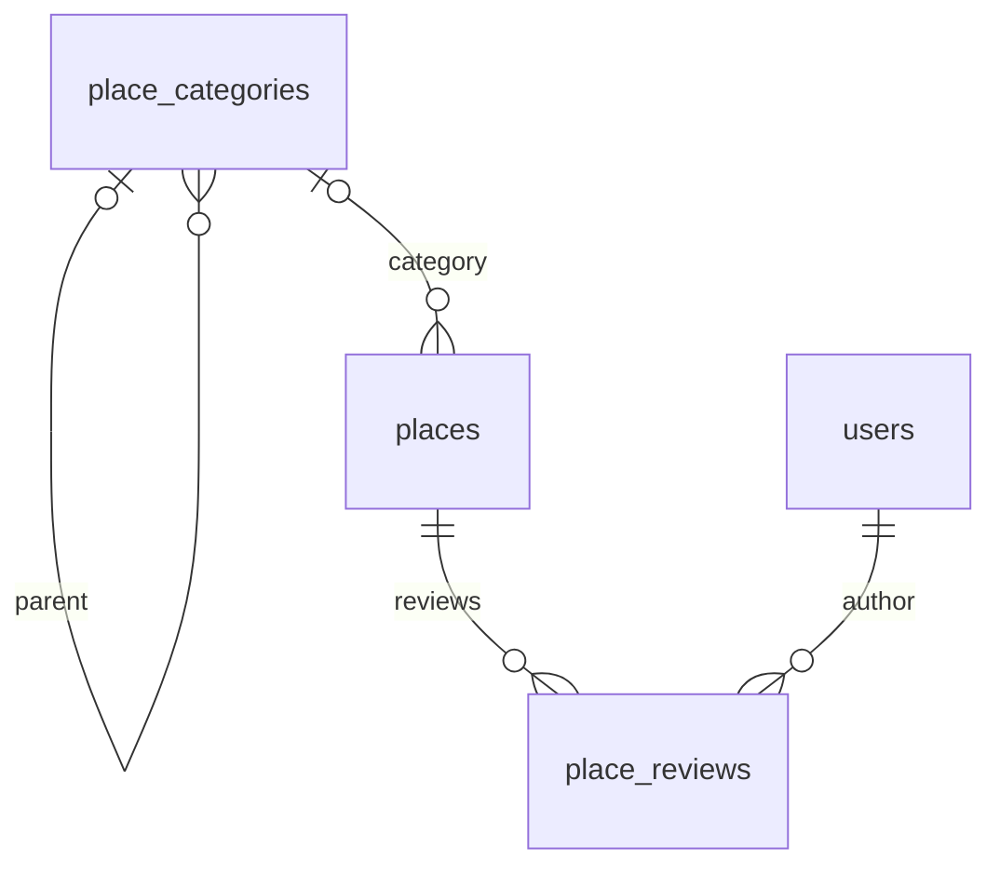

# 장소·분류·후기 DDL v2

작성일: 2026-10-22. [place_schema_v2.sql](place_schema_v2.sql)이 현재 통합 생성안이다. 2026-10-22 11:38:48 KST에 개발 DB travel_test.public에 적용했다. [실행 기록](place_schema_v2_applied_2026-10-22.md)을 참고한다. 이전 단일 테이블 v1과 연속 실행하는 파일이 아니라 v1을 대체하는 신규 생성용 파일이다. 기존 테이블이 이미 있으면 별도 마이그레이션과 데이터 이관이 필요하다.

## 테이블과 관계

| 테이블 | 한글명 | 컬럼 수 | 데이터 출처 |
|---|---|---:|---|
| `place_categories` | 장소 분류 | 5 | TourAPI lclsSystmCode2 + 내부 계층 연결 |
| `places` | 장소 정보 | 32 | TourAPI 목록·상세·이미지·행사·동기화 API + 내부 관리값 |
| `place_reviews` | 장소 후기 | 7 | 로그인 사용자 입력 + 내부 관리값 |

기존 users 테이블은 생성하거나 변경하지 않는다. place_category_map, place_sources, 좋아요·수집 이력·ORS·ITS 전용 테이블은 생성하지 않는다.



분류는 한 테이블에 대·중·소 단계별 행을 저장한다. places는 소분류 하나를 category_id로 참조한다. 분류가 없거나 매칭되지 않으면 NULL이다. 대·중분류는 상위 행으로 조회한다. 분류 이름은 중복 가능하며 API 분류 코드에 UNIQUE를 둔다.

## v1에서 바뀐 부분

- places의 category1/2/3_code와 category1/2/3_name 6개 컬럼을 제거하고 category_id 하나로 대체했다. 35개에서 30개로 줄인 뒤 source_url/source_type 2개를 추가해 현재 32개다.
- place_categories의 5개 컬럼과 자기 참조 FK를 추가했다. 자세한 필드는 [분류 컬럼 설계](place_category_design_v1.md)를 참고한다.
- place_reviews의 7개 컬럼과 장소·회원 FK를 추가했다.
- content_id, raw_data, source_updated_at, last_synced_at은 places에서 유지한다.
- 장소의 다른 컬럼과 API 대응은 [현재 컬럼 명세](table_spec_2026-10-18.md)을 참고한다. 최신 분류 연결·리뷰 정책은 이 v2 문서를 우선한다.

## 수집 출처 컬럼

| 컬럼 | 한글명 | 타입 | 저장값 |
|---|---|---|---|
| `source_url` | 마지막 수집 URL | TEXT, NULL 허용 | 마지막 성공한 장소 API의 요청 URL. 인증키 제외 |
| `source_type` | 수집 방식 | VARCHAR(20), NULL 허용 | `API` 또는 `CRAWLING`; 미확인은 NULL |

현재 수집기는 API를 저장한다. 크롤링 기능은 아직 구현하지 않았다. 여러 API를 조합하므로 raw_data의 API별 source_url/source_urls에도 쿼리를 포함한 주소를 남긴다. 마지막 호출은 이미지 상세처럼 빈 배열을 성공 반환한 경우도 포함한다. 출처만 바뀌면 updated_at을 변경하지 않고 last_synced_at으로 수집 시점을 확인한다.

기존 개발 DB는 [변경 SQL](migrations/20261022_add_place_source_metadata.sql)을 적용해 2026-10-22 13:40:16 KST에 32컬럼으로 변경했다. 과거 요청 쿼리는 복원하지 않고, 확인 가능한 TourAPI 원본의 엔드포인트 주소만 보완했다. 이후 재수집분부터 실제 요청 쿼리를 저장한다. 새 환경은 최신 생성 DDL만 실행한다.

## place_reviews 컬럼

| 컬럼 | 한글명 | 타입 | 규칙 |
|---|---|---|---|
| `review_id` | 리뷰 ID | UUID | PK, 서버에서 생성 |
| `place_id` | 장소 ID | UUID | 필수, places.place_id 참조 |
| `user_id` | 작성자 ID | UUID | 필수, users.user_id 참조 |
| `rating` | 별점 | SMALLINT | 필수, 1~5 |
| `review_text` | 후기 내용 | TEXT | NULL 허용, 별점만 작성 가능 |
| `created_at` | 작성 일시 | TIMESTAMPTZ | 기본 현재 시각 |
| `updated_at` | 수정 일시 | TIMESTAMPTZ | INSERT 기본 현재 시각, UPDATE 시 서버에서 변경 |

작성자 ID는 기존 로그인 사용자 ID를 가져온다. 리뷰를 쓸 때 새 사용자 번호를 생성하지 않는다. 한 사용자의 같은 장소에 대한 리뷰 개수 제한은 아직 정하지 않았으므로 UNIQUE(user_id, place_id)는 두지 않는다. 기존 ERD의 후기 컬럼에 수정 일시 하나를 추가했다. 좋아요 기능은 포함하지 않는다.

## 회원 ID 타입 확인

사용자 결정에 따라 이 DDL은 팀장님 ERD와 동일하게 users.user_id를 UUID로 전제하고 place_reviews.user_id도 UUID로 작성했다. 리뷰 작성 시 기존 사용자 UUID를 연결하며 새 사용자 ID를 생성하지 않는다.

현재 `BackEnd/NestJS/src/users/entities/user.entity.ts`의 `@PrimaryGeneratedColumn({ name: 'user_id' })` 선언은 정수 자동 증가 전략이므로 UUID 설계와 차이가 있다. TypeScript의 id 프로퍼티가 string이라고 쓰인 것과 PostgreSQL 컬럼 타입은 구분한다. 실제 개발 DB travel_test.public.users.user_id는 UUID PK이고 기본값은 gen_random_uuid()인 것을 실행 전에 확인했다. 다른 DB에 적용할 때도 아래 조회로 타입을 확인한다. 회원 ID가 정수인 환경에서는 회원 ID 이관과 백엔드 UUID 전략 변경이 별도 작업이다. 이번 작업에서는 회원 코드·회원 스키마·시퀀스를 변경하지 않았다.

```sql
SELECT table_schema, column_name, data_type, column_default, is_identity
FROM information_schema.columns
WHERE table_schema = current_schema()
  AND table_name = 'users'
  AND column_name = 'user_id';
```

## 생성·운영 규칙

1. 대상 DB의 스키마와 기존 users.user_id의 타입·PK를 확인한다. users와 새 테이블이 같은 스키마에 있다는 전제다.
2. 새 테이블 생성용 [DDL 전체](place_schema_v2.sql)를 BEGIN부터 COMMIT까지 스크립트로 실행한다. 개발 DB에는 이미 실행했으므로 다시 생성하지 않고 후속 변경은 별도 마이그레이션으로 처리한다.
3. 분류를 대분류 → 중분류 → 소분류 순서로 저장한 뒤 장소를 수집한다. 재수집 때 category_code/content_id로 UPSERT하고 내부 UUID를 유지한다.
4. 별점은 1~5, 위경도는 함께 제공하고 범위를 지킨다. images/fees는 JSON 배열, raw_data는 JSON 객체다.
5. UUID는 애플리케이션에서 전달하며 별도 DB 확장은 요구하지 않는다. updated_at 자동 갱신 트리거는 없으므로 UPDATE에서 직접 바꾼다.

FK는 기본 NO ACTION으로 두어 상위 분류·장소·회원 삭제 시 연결된 데이터가 자동 연쇄 삭제되지 않는다. 장소의 비표출은 is_active=false로 처리한다.

FK만으로 분류 부모의 단계와 places가 참조하는 분류의 소분류 여부를 검사할 수는 없다. 저장 로직에서 중분류 부모=대분류, 소분류 부모=중분류, 장소 연결=소분류를 검증한다. JSON 내부 이미지·요금 항목, HTML 안전 표시, 리뷰 작성·수정 권한도 애플리케이션이 검증한다.

인덱스는 분류 부모, 장소 분류, 활성 장소 지역·타입, 장소별 최신 후기, 사용자별 최신 후기에 둔다. PK·UNIQUE의 인덱스는 PostgreSQL이 생성한다. 모든 컬럼에 원본 API 또는 내부 생성·사용자 입력 여부를 COMMENT로 기록했다.

## 검증

PGlite 임시 PostgreSQL 엔진의 27개 검증에서는 전체 DDL·저장·외래키·별점·JSON·좌표·기간·중복 방지·삭제 제한을 확인했다. 정수형 users에 대한 타입 불일치와 롤백도 확인했다. 이후 실제 개발 DB에 적용하고 세 테이블·42개 컬럼·FK 4개·컬럼 주석 42개를 확인했다. 임시 엔진의 데이터 저장 검증과 실제 개발 DB의 스키마 생성 검증은 구분하며, 후속 출처 컬럼 추가로 현재 44개 컬럼·주석이며, 실제 API 수집 검증은 [수집 안내](../BackEnd/NestJS/docs/TOUR_INGESTION.md)에 기록했다.
