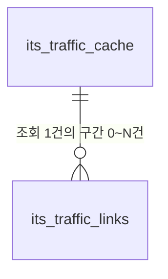

# ITS·ORS 캐시 테이블 v2

작성: 2026-10-23. [신규 생성 DDL](routing_cache_schema_v2.sql). 실제 DB에 실행하지 않은 설계다. 테이블을 최소한으로 유지하면서 주요 응답을 일반 컬럼에 저장한다.

| 테이블 | 한글명 | 컬럼 수 | 역할 |
|---|---|---:|---|
| ors_route_cache | ORS 경로 캐시 | 18 | 요청 조건별 거리·기본 시간·경로·상세 구간 시간, 기본 24시간 |
| its_traffic_cache | ITS 조회 캐시 | 7 | 조회 조건·건수·수집/만료 시각, 기본 5분 |
| its_traffic_links | ITS 도로 구간 관측값 | 10 | 한 조회에서 받은 구간별 속도·통행시간·관측 시각 |

## 관계와 적용 범위



ORS는 독립 캐시다. ITS는 헤더 1건에 구간 0~N건이며 자식 PK는 `(cache_id, link_id)`다. 같은 도로가 서로 다른 조회에 포함될 수 있으므로 link_id에 전역 UNIQUE를 걸지 않는다. 부모 캐시 삭제 시 구간도 삭제한다. 영구 도로망·조회 이력 테이블이 아니다.

**ORS와 ITS 사이에 직접 FK를 만들지 않는다.** ITS linkId와 ORS 도로 ID는 같지 않다. NODELINK 형상·방향·노드·지도 버전을 검증한 공간 매칭이 별도로 필요하다. 이 DDL은 정체 반영 시간 계산이나 경로 최적화를 구현하지 않는다. 장소/회원/여행 테이블 FK도 두지 않아 독립 생성할 수 있다.

후속 구현으로 [NestJS 캐시 모듈](../BackEnd/NestJS/src/routing-cache/README.md)을 추가했다. 요청 시 DB 캐시를 확인하고 ORS 24시간/ITS 5분 만료 후 다시 조회하며, 매분 만료 데이터를 정리한다. 서버 시작 때 필수 테이블/컬럼 누락도 로그로 알린다. 실제 대상 DB의 DDL 실행과 서버 배포/키 설정은 별도이며, **테이블 생성만으로 실행 중인 구버전 서버에 캐시 기능이 생기지는 않는다.**

## ORS 컬럼

출처: `POST https://api.heigit.org/openrouteservice/v2/directions/{profile}/geojson`.

| 컬럼 | 한글명 | 출처/의미 |
|---|---|---|
| cache_id | 캐시 ID | 서버 UUID |
| request_hash | 요청 해시 | 정규화한 실제 요청의 SHA-256, 같은 조건의 중복 방지 |
| request_params | 요청 조건 | 경유지를 포함한 좌표·순서·프로필·선호·옵션·응답 계약 버전, 키 제외 |
| profile | 이동 프로필 | driving-car / foot-walking |
| preference | 경로 선택 조건 | recommended / shortest |
| origin_longitude | 출발 경도 | 요청 첫 좌표 |
| origin_latitude | 출발 위도 | 요청 첫 좌표 |
| destination_longitude | 도착 경도 | 요청 마지막 좌표 |
| destination_latitude | 도착 위도 | 요청 마지막 좌표 |
| distance_meters | 이동거리(m) | features[0].properties.summary.distance, units=m |
| duration_seconds | 기본 예상시간(초) | features[0].properties.summary.duration, 실시간 정체 미반영 |
| geometry | 경로 좌표 | features[0].geometry, GeoJSON LineString |
| time_spans | 상세 구간 시간 | segments[].steps[].way_points/duration에서 가공 |
| attribution | 출처 문구 | metadata.attribution, 미제공 NULL |
| warnings | 경고 목록 | properties.warnings, 없으면 [] |
| source_url | 호출 API 주소 | 인증정보와 쿼리를 제외한 엔드포인트 |
| fetched_at | 수집 시각 | 서버 기록 |
| expires_at | 만료 시각 | 기본 수집 시점부터 24시간 |

좌표 순서는 `[경도, 위도]`다. JSON은 요청 가변 조건·좌표/경고/상세 시간 배열에만 사용하고, 조인/정렬에 사용할 거리·시간·프로필·시각은 별도 컬럼이다.

상세 구간 시간 형식:

```json
[
  {"fromIndex": 0, "toIndex": 3, "durationSeconds": 45.2},
  {"fromIndex": 3, "toIndex": 8, "durationSeconds": 110.5}
]
```

위 값은 형식 예시다. 상세를 받으려면 ORS 요청에 필요한 instructions 옵션을 설정하고 실제 응답을 검증해야 한다. 상세가 없는 `[]` 캐시를 시간대별 위치 계산에 사용하지 않는다. 인덱스 범위/연속성·시간 합계·좌표 배열의 각 원소는 서버 검증 대상이다. summary-only/detail 응답은 request_params의 계약 버전/옵션과 request_hash로 구분한다. 출발·도착이 같아도 경유지·이동수단·선호 조건이 다르면 별도 캐시다.

## ITS 컬럼

출처: `GET https://openapi.its.go.kr:9443/trafficInfo`, 최상위 header/body 응답.

| 테이블 | 컬럼 | 한글명 / 출처 |
|---|---|---|
| its_traffic_cache | cache_id | 조회 캐시 UUID, 서버 생성 |
| its_traffic_cache | request_hash | 키를 제외한 실제 조회 조건의 SHA-256 |
| its_traffic_cache | request_params | minX/maxX/minY/maxY·type/drcType 등 요청 조건 |
| its_traffic_cache | item_count | 실제 저장한 서로 다른 링크 수 |
| its_traffic_cache | source_url | 인증정보·쿼리 없는 API 주소 |
| its_traffic_cache | fetched_at | 서버 수집 시각 |
| its_traffic_cache | expires_at | 기본 5분 뒤 만료 |
| its_traffic_links | cache_id | 부모 조회 캐시 ID, FK |
| its_traffic_links | link_id | body.items[].linkId, 문자열 |
| its_traffic_links | start_node_id | startNodeId, 시작 노드 |
| its_traffic_links | end_node_id | endNodeId, 끝 노드 |
| its_traffic_links | road_name | roadName, 도로명 |
| its_traffic_links | road_direction | roadDrcType, 원천 방향 값 |
| its_traffic_links | link_no | linkNo, 원천 구간 순번 값 |
| its_traffic_links | speed | speed 원천 숫자. 단위 확인 전 등급 계산 보류 |
| its_traffic_links | travel_time_seconds | travelTime, 구간 통행시간(초) |
| its_traffic_links | observed_at | createdDate, 원천 관측 시각 |

ID의 선행 0을 보존한다. 빈 선택 문자열은 NULL로 정리한다. travelTime=0/결측은 의미 미확인으로 NULL, 실제 speed=0 관측은 0을 보존한다. 원천 시각이 오래되었거나 없을 수 있어 fetched_at만으로 현재 정체라고 표시하지 않는다. 현재 교통을 미래 여행 시각의 예측이라고 표현하지 않는다.

## 생성과 조회·정리

1. 접속 대상 DB/스키마와 테이블 존재 여부를 확인한다.
2. 세 테이블이 없는 환경에서 SQL 전체를 BEGIN부터 COMMIT까지 실행한다. 이름이 이미 있으면 중단하며 기존 구조에 맞는 별도 변경 SQL이 필요하다. 실패한 트랜잭션은 ROLLBACK한다.
3. UUID·정규화 요청·해시·응답을 서버가 저장한다. 기본값을 덮어 수집 시각을 넣으면 만료 시각도 같은 수집 시각 기준으로 전달한다.
4. UPSERT 시 cache_id는 유지하고 fetched_at/expires_at과 응답을 함께 갱신한다. ITS는 부모 UPSERT → 그 조회의 기존 구간 삭제 → 새 구간 INSERT → item_count 검사를 하나의 트랜잭션으로 처리한다. 정상 빈 결과도 이전 구간을 지운다.
5. 캐시는 `expires_at > CURRENT_TIMESTAMP` 조건으로 읽는다. 삭제 전이라도 만료된 값을 유효한 결과로 반환하지 않는다.

조회 예시:

```sql
SELECT * FROM ors_route_cache
WHERE request_hash = :request_hash AND expires_at > CURRENT_TIMESTAMP;

SELECT c.cache_id, c.fetched_at, c.expires_at,
       l.link_id, l.start_node_id, l.end_node_id, l.road_name,
       l.road_direction, l.link_no, l.speed, l.travel_time_seconds, l.observed_at
FROM its_traffic_cache c
LEFT JOIN its_traffic_links l ON l.cache_id = c.cache_id
WHERE c.request_hash = :request_hash AND c.expires_at > CURRENT_TIMESTAMP;
```

`:request_hash`는 클라이언트 바인딩 예시이며 서버에서는 파라미터화 쿼리를 사용한다. LEFT JOIN은 정상 빈 캐시도 조회하기 위한 것이다.

만료된 행은 새 백엔드의 매분 자동 정리 작업이 실제로 삭제한다. 아래는 수동 정리 참고 SQL이며 생성 스크립트에 포함하지 않았다. 실제 코드에는 동시 실행 시 행 잠금을 피하는 SKIP LOCKED도 적용했다.

```sql
DELETE FROM ors_route_cache
WHERE cache_id IN (
  SELECT cache_id FROM ors_route_cache
  WHERE expires_at <= CURRENT_TIMESTAMP ORDER BY expires_at LIMIT 1000
);

DELETE FROM its_traffic_cache
WHERE cache_id IN (
  SELECT cache_id FROM its_traffic_cache
  WHERE expires_at <= CURRENT_TIMESTAMP ORDER BY expires_at LIMIT 1000
);
```

ITS 자식은 FK의 ON DELETE CASCADE로 삭제한다. TTL은 현재 서비스의 제안 값이며 제공자의 실시간 정확도·호출 한도·보관 의무를 뜻하지 않는다. 캐시에는 인증키·인증 헤더·apiKey/serviceKey가 있는 URL을 저장하지 않는다. source_url CHECK는 쿼리 등을 차단하지만 JSON 내부 비밀값 정제는 서버 책임이다.

**TourAPI 배치와 별개다.** TourAPI 배치가 요구하는 place_categories/places/place_reviews는 [장소 DDL](place_schema_v2.sql)로 준비해야 하며 ITS·ORS 테이블만 생성해도 TourAPI 배치 오류가 해결되지는 않는다.

## 검증 결과

2026-10-23, Node 22.23.3과 격리 PGlite에서 28개 검증을 통과했다. 세 테이블의 컬럼 수 18/7/10과 35개 컬럼 주석, 기본 만료시간, 해시 중복/형식, 좌표/유한 숫자/JSON 외형/출처 URL/시각 제약, ITS 복합 PK·FK·부모 연쇄 삭제, 서로 다른 조회의 동일 링크 허용, 정상 빈 결과, 구간 교체 실패 롤백, 만료 조회 제외/제한 삭제, 신규 생성 SQL 재실행 시 기존 데이터 보존을 검사했다.

검증 스크립트는 저장소 밖 로컬 작업 폴더에만 보관했다. 실제 운영 PostgreSQL 버전·권한·스키마, 원격 DB 적용, API 실호출, 서버 캐시 연동·스케줄러는 이 검증에 포함하지 않는다. JSON 배열 내부 값과 실제 원천 데이터의 의미 검증도 서버 구현이 필요하다.
